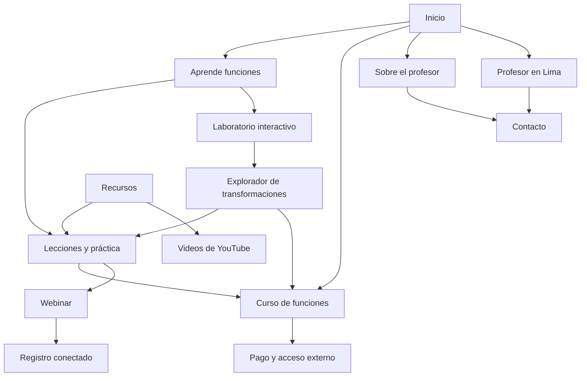

# Arquitectura del sitio del profesor de matemática

Fecha: 7 de octubre de 2026. Etapa actual: estructura del sitio. Documento principal para la siguiente implementación.

## 1. Dirección acordada y alcance de esta etapa

El usuario elige funciones como especialidad inicial: ayudar a pasar de bases algebraicas a una comprensión que permita abordar cálculo. El sitio debe construir autoridad desde Lima, vender un curso digital, publicar recursos educativos, incorporar aplicaciones web interactivas y alojar la presentación de webinars. Los canales principales serán YouTube, TikTok e Instagram.

Orden de trabajo solicitado: estructura → funcionalidades → branding → implementación y revisiones → repositorio. Este documento completa la estructura; no fija aún el branding, desarrolla el sitio, publica páginas ni crea el repositorio. Las capacidades descritas son requisitos que se detallarán en la etapa siguiente.

Confirmado por el usuario: audiencia de últimos años de secundaria y primeros ciclos universitarios; “ads” se refería a aplicaciones web educativas interactivas que irá incorporando. Contenido y curso en español como punto de partida; enseñanza local real por confirmar. El nombre, credenciales, precio, fotografías, dominio y fechas de webinar permanecen como datos por completar.

La aspiración de ser un referente mundial se traduce en calidad educativa comprobable, una especialidad reconocible, contenidos útiles y una experiencia consistente. Ninguna estructura puede asegurar ser el número uno ni alcanzar una posición específica en Google.

## 2. Posicionamiento y oferta educativa

Mensaje de trabajo: **“Comprende funciones y construye las bases para cálculo, con explicaciones visuales y práctica guiada”.**

La marca principal será la del profesor, con origen en Lima y alcance online. No limitar todo el sitio a Lima: la página local atenderá esa búsqueda, mientras el contenido educativo y el curso serán útiles para públicos de otros países.

Público principal provisional: quien puede operar expresiones algebraicas, pero tiene dificultades para relacionar fórmula, gráfica y comportamiento de una función. La preparación escolar general puede seguir siendo un servicio local solo si se ofrece realmente; no desplazar la especialidad inicial con un catálogo de veinte cursos.

Los temas de funciones también cuentan con abundante contenido gratuito. Khan Academy ofrece dominio, rango, transformaciones y otras habilidades. El producto pagado necesita una ruta de práctica y un resultado concreto, no solo más videos de definiciones. Fuente: [contenido de funciones de Khan Academy](https://www.khanacademy.org/math/algebra2/alg-functions).

Curso provisional: **Funciones para empezar cálculo**. Objetivo: conectar expresiones, gráficas, dominio, rango, transformaciones y composición, e interpretar variación y comportamiento para abordar después límites y derivadas. Entender funciones es una base importante, pero no reemplaza otras bases algebraicas y trigonométricas cuando el curso de cálculo las requiere.

Una primera edición puede concentrarse en funciones reales de una variable y familias polinómicas y racionales, con exponenciales/logarítmicas según alcance. El temario final, duración y práctica se decidirán en la etapa de funcionalidades/producto, considerando dominio docente y tiempo de producción. No copiar el precio ni las 16 lecciones de la propuesta anterior de ecuaciones.

Valor comercial propuesto: diagnóstico inicial, recorrido ordenado según dificultades, problemas graduados, soluciones comentadas y evaluación final. Elegir qué parte será automatizada o guiada en la siguiente etapa; no anunciar adaptación personalizada si solo habrá una lista fija de videos.

## 3. Mapa de páginas: primera versión

Nueve páginas principales, tres lecciones de arranque, una primera aplicación y dos páginas de condiciones. Es una estructura compacta con plantillas reutilizables; no son quince diseños independientes.

| Página y ruta propuesta | Necesidad que resuelve | Acción principal | Estado en fase 1 |
| --- | --- | --- | --- |
| Inicio `/` | Entender quién enseña, su especialidad y por dónde empezar | Explorar funciones | Página completa con datos reales disponibles |
| Profesor `/sobre-mi/` | Evaluar formación, experiencia y método | Ver una explicación | Datos biográficos pendientes identificados en borrador |
| Servicio local `/profesor-matematicas-lima/` | Encontrar al profesor y conocer atención en Lima | Consultar disponibilidad | Modalidades y cobertura reales por confirmar |
| Centro educativo `/aprende/funciones/` | Identificar dificultades y seguir una ruta de aprendizaje | Elegir una lección | Contenido propio sustancial |
| Curso `/cursos/funciones-para-calculo/` | Evaluar programa, práctica, condiciones y compra | Comprar cuando esté disponible | Borrador hasta validar producto y cobro |
| Webinar `/webinars/funciones-antes-del-calculo/` | Conocer una clase abierta y cómo asistir | Registrarse cuando haya fecha y conexión | Borrador o aviso honesto de próxima edición |
| Recursos `/recursos/` | Encontrar videos, artículos y ejercicios útiles | Abrir un recurso | Tres recursos iniciales, sin categorías vacías |
| Laboratorio `/laboratorio/` | Encontrar aplicaciones para explorar conceptos | Abrir el explorador de funciones | Una herramienta inicial y catálogo ampliable |
| Aplicación `/laboratorio/transformaciones-de-funciones/` | Relacionar cambios de parámetros y gráfica | Explorar y practicar | Primera aplicación propuesta; especificación en la etapa siguiente |
| Contacto `/contacto/` | Resolver dudas sobre curso o enseñanza | Usar el canal real de contacto | Integración por definir |
| Lección `/aprende/funciones/dominio-y-rango/` | Resolver una dificultad concreta | Practicar y continuar | Artículo, ejemplos y video cuando exista |
| Lección `/aprende/funciones/interpretar-graficas/` | Relacionar expresión y representación | Practicar y continuar | Artículo, ejemplos y video cuando exista |
| Lección `/aprende/funciones/transformaciones/` | Comprender cambios en gráficas | Practicar y continuar | Artículo, ejemplos y video cuando exista |
| Privacidad `/privacidad/` | Entender tratamiento de datos y herramientas | Consultar información | Ajustar a operaciones efectivas antes de recoger datos |
| Condiciones `/condiciones/` | Entender acceso, compra, soporte y devoluciones | Revisar condiciones | Ajustar al producto y plataforma reales |

Si aún no se ofrecen servicios presenciales, la página local explicará que el profesor está en Lima y enseña online; no anunciará domicilio, oficinas o distritos atendidos inexistentes. Un curso disponible internacionalmente no necesita páginas duplicadas por ciudad.

No incluir inicialmente: panel de alumnos propio, chat con IA, red social, foro, tienda multicurso, afiliación, páginas para cada distrito o versiones de países vacías. Se podrán incorporar cuando correspondan a una necesidad demostrada.

## 4. Navegación y relaciones entre páginas

Cabecera: marca del profesor como enlace al inicio; Aprende; Laboratorio; Curso; Webinar; Sobre mí. “Aprende” da acceso al centro de funciones y recursos. Contacto permanece accesible desde cabecera o footer según espacio. En móvil, menú sencillo con los mismos destinos. Footer: página Lima, contacto, recursos, redes reales, privacidad y condiciones.

El curso será la acción comercial principal. El webinar será una alternativa para quien quiere una demostración más extensa. No colocar dos botones de igual importancia en cada bloque.

Mapa:

No es necesario que el usuario pase por todas las páginas. Un enlace desde YouTube puede llevar directamente a la oferta. Una persona con intención de contratar al profesor en Lima llega al servicio local.

## 5. Composición de las páginas principales

### Inicio

1. Presentación: nombre, especialidad y enseñanza online desde Lima, según disponibilidad real.
2. Explicación visual breve del método: conectar fórmula, gráfica y razonamiento.
3. Accesos a las tres dificultades iniciales de funciones.
   Incluir también una muestra o acceso visible a la aplicación de transformaciones; el usuario podrá aprender haciendo.
4. Presentación del curso: objetivo y lo que aporta la práctica organizada.
5. Invitación al webinar, solo si existe una edición comunicable.
6. Experiencia y pruebas reales: credenciales y ejemplo de explicación; testimonios solo cuando estén autorizados.
7. Bloque local: enseñanza desde Lima, modalidades y contacto verdaderos.

Primera pantalla: especialidad comprensible, identidad y siguiente paso claro. Evitar llenar el inicio de promesas universales o llamadas a todas las redes.

### Página del profesor

Historia profesional breve; formación comprobable; experiencia; niveles atendidos; forma de enseñar; explicación grabada; enlaces a perfiles reales. Una foto auténtica aporta identidad. Los premios, alumnos, años y resultados no se inventan para completar el diseño.

### Página local

Título de trabajo: “Profesor de matemática en Lima: funciones y bases para cálculo”. Incluir modalidades, audiencia, horarios/contacto, metodología, cobertura si existe, preguntas de servicio y enlaces al curso y contenidos.

Prioridad: que alguien pueda decidir si el servicio le corresponde. Las consultas “profesor de matemática en Lima” y “clases de funciones en Lima” son candidatos, no palabras con volumen ni dificultad validados en esta investigación.

### Centro de funciones

Problemas reconocibles; prerrequisitos; mapa de ruta; tres lecciones; video de orientación; acceso al laboratorio; muestra de práctica; invitación al curso o webinar. El sitio aporta una secuencia que las redes fragmentan.

### Plantilla de lección

Pregunta concreta → idea central → gráfica o representación legible → ejemplo propio resuelto → ejercicio para intentar → respuesta explicada → error frecuente → siguiente lección → oferta relacionada.

Mostrar autor y fecha de revisión real. Evitar páginas hechas únicamente de un video incrustado y texto genérico. Cada lección debe resolver una necesidad por sí misma.

### Venta del curso

Resultado y público; prerrequisitos; muestra gratuita; temario; práctica y materiales; modalidad/duración; profesor; precio y moneda; acceso y soporte; condiciones; preguntas frecuentes; compra.

No venderlo como una biblioteca de videos ni anunciar garantía de aprobar cálculo. El visitante debe comprender qué hará, qué recibirá y qué esfuerzo de práctica se espera.

### Webinar

Título, contenido, público, profesor, fecha/hora con zona horaria, duración, modalidad, registro y confirmación. Después de realizarlo: actualizar a grabación o próxima edición; evitar dejar una fecha vencida como evento activo.

La primera sesión propuesta: “Por qué entender una fórmula no basta: dominio, gráfica y comportamiento antes de cálculo”. Enseñar un problema completo y mostrar el itinerario del curso al final.

### Recursos y contacto

Recursos organiza contenido ya publicado, no repite íntegramente las lecciones. Contacto presenta canales existentes, qué consultas se atienden y tiempos reales de respuesta. No fingir formularios que envían información o suscripciones que guardan datos.

## 6. Recorridos comerciales y educativos

Ruta directa acordada: TikTok → explicación específica en YouTube → página del curso → pago → acceso. Instagram reutiliza el contenido y enlaza al mismo destino disponible.

Ruta de confianza adicional: contenido → webinar → presentación del curso → compra. Es una opción; no una obligación antes de comprar.

Ruta local: búsqueda de profesor en Lima → página local → método/experiencia → consulta o curso, según necesidad.

Ruta educativa: búsqueda sobre dominio/rango → lección → práctica → siguiente lección → curso cuando el usuario necesita una ruta completa.

Cada pieza debe enlazar a un destino coherente: un video de dominio y rango no dirige a una página genérica de primaria. Mantener contenido útil completo en abierto y explicar qué añade el producto.

## 7. SEO local, autoridad y expansión

Desde la primera versión: páginas rápidas y legibles en móvil; contenido principal accesible a buscadores; títulos y descripciones particulares; una URL estable por contenido; enlaces internos; sitemap; ausencia de enlaces rotos; identidad consistente; registro de búsquedas cuando se conecte la cuenta correspondiente. No fijar el stack técnico antes de la etapa de funcionalidades.

Datos estructurados según contenido real: persona/autoria, artículos y videos disponibles; curso y eventos solo con datos reales y soporte vigente a verificar durante implementación. No inventar valoraciones ni suponer que añadir schema garantiza resultados enriquecidos.

Google recomienda contenido útil creado para las personas. Autoridad se construye mostrando experiencia, precisión, ejemplos, referencias cuando correspondan y revisión de errores. Fuente: [guía oficial de contenido útil](https://developers.google.com/search/docs/fundamentals/creating-helpful-content).

Perfil de Empresa de Google: revisarlo únicamente si hay atención presencial real que cumple sus reglas. Google exige contacto presencial para elegibilidad y excluye negocios exclusivamente online. El SEO orgánico del sitio sigue siendo posible con enseñanza online desde Lima. Fuente: [elegibilidad oficial](https://support.google.com/business/answer/13763036?hl=en-11).

Arquitectura internacional: conservar rutas de aprendizaje en español, independientes de Lima. No abrir veinte subdominios ni páginas regionales vacías. En fase 2, adaptar páginas solo cuando cambien currículo, oferta o información de mercado. En fase 3, incorporar inglés con enseñanza y materiales revisados; aplicar idiomas/regiones cuando existan versiones equivalentes auténticas. Fuente: [versiones localizadas de Google](https://developers.google.com/search/docs/specialty/international/localized-versions).

Objetivos medibles: consultas locales pertinentes; tráfico educativo relevante; paso de contenido a oferta; compras; alumnos que practican/completan; recomendaciones y enlaces educativos auténticos. La posición en búsquedas es una señal, no el único objetivo.

## 8. Laboratorio de aplicaciones educativas

Las aplicaciones son parte del producto educativo y de la propuesta de valor. No se refiere a anuncios publicitarios. El laboratorio tendrá una página por herramienta con objetivo, aplicación utilizable, explicación breve, ejercicio guiado y vínculo a la lección o curso correspondiente.

Primera aplicación propuesta: **Explorador de transformaciones de funciones**. Familia inicial f(x) = a(x − h)² + k. El alumno modifica a, h y k, compara con y = x² y conecta expresión y gráfica. Añadir preguntas como “predice qué ocurrirá al cambiar h y después compruébalo”. La especificación de controles, límites, accesibilidad, estados y corrección de ejercicios pertenece a la siguiente etapa.

El simulador debe tratar correctamente a = 0: la función es constante y no una parábola. Los retos sobre rango y vértice deben respetar ese caso o limitar explícitamente el parámetro. Esto se comprobará en la revisión matemática.

Fase 1: una herramienta funcional, sin cuenta obligatoria, junto a una lección y un reto guiado. Otras aplicaciones pueden existir como tarjetas de planificación en el prototipo, pero no como herramientas públicas que aparentan funcionar.

Fase 2: exploradores de dominio/rango, composición/inversa o aproximación a límites según dificultades observadas. No producir simultáneamente una calculadora general y múltiples simuladores.

Fase 3: rutas y progreso guardado si los alumnos lo necesitan; cuentas y recomendaciones automáticas solo con requisitos definidos. El laboratorio no promete diagnóstico adaptativo hasta que esa funcionalidad exista.

Monetización propuesta: mantener una aplicación abierta útil para demostrar el método. El curso aporta secuencia, problemas, soluciones y práctica estructurada alrededor de ella. No obligar a pagar para entender una demostración gratuita ni tratar un simulador aislado como prueba de demanda comercial. Registrar si sus usuarios continúan a las lecciones y a la oferta.

## 9. Placeholders: qué preparar y qué publicar

En prototipo: `[NOMBRE]`, `[BIOGRAFÍA REAL]`, `[FOTO]`, `[PRECIO]`, `[FECHA WEBINAR]`, `[LINK CURSO]`, `[LINK YOUTUBE]`, `[LINK TIKTOK]`, `[LINK INSTAGRAM]`, `[CONTACTO]`. Usarlos para construir y revisar sin inventar datos personales o comerciales.

Antes de publicar: reemplazar datos que afecten una decisión. Si el curso o webinar no existe, mostrar su estado real u omitir la acción de compra/registro. Prototipos y páginas vacías quedan fuera de indexación y del sitemap. No publicar reseñas o ventas de ejemplo como si fueran reales.

No debe verse un botón de compra habilitado si no hay checkout funcional, ni “Registro recibido” si ningún sistema guarda la solicitud. Los borradores pueden mostrar componentes inactivos identificados para revisión; la versión pública necesita estados honestos.

## 10. Fases de producto y calendario de ejecución

Las fases de expansión del sitio son distintas de las etapas de trabajo. Todas las etapas de estructura, funcionalidades, branding, implementación y QA se completan antes de publicar la fase 1.

| Fase del sitio | Alcance | Criterio de avance |
| --- | --- | --- |
| 1. Lima y especialidad | Identidad, página local, funciones, curso, webinar, tres recursos, laboratorio con una aplicación, contacto y condiciones | Recorridos comprensibles; herramienta matemáticamente correcta; datos reales; compras/registros conectados o estado pendiente honesto |
| 2. Latinoamérica | Más contenido y aplicaciones según consultas, webinars repetibles, oferta adaptada, mejora de conversión | Ventas/consultas y evidencia de aprendizaje; demanda por país identificada |
| 3. Internacional | Inglés revisado, nuevos programas, alianzas y progreso/cuentas si hace falta | Capacidad docente y operativa; demanda que justifique cada expansión |

Implementación propuesta en 7–10 días de trabajo, condicionada a materiales disponibles y horas del profesor; no es un plazo de posicionamiento en Google:

1. Día 1: cerrar estructura y público.
2. Día 2: especificar funcionalidades, dependencias y estados de cada recorrido.
3. Día 3: definir branding, voz, fotografía y criterios visuales.
4. Días 4–6: construir páginas y plantillas, implementar la primera aplicación, integrar contenidos e insertar placeholders donde falten datos.
5. Día 7: conectar los canales disponibles de curso, contacto y webinar; comprobar entrega o limitar honestamente lo que aún esté pendiente.
6. Días 8–9: revisión matemática, móvil, accesibilidad, navegación, enlaces, estados de error, pago y registro cuando estén activos.
7. Día 10: preparar repositorio y publicación de lo que esté completo. El dominio y cuentas externas se conectan cuando estén disponibles.

El sitio puede estar preparado en días; producir el curso completo y construir reputación son trabajos distintos, con sus propios plazos. No retrasar toda la presencia pública por páginas de venta o webinars que todavía estén en borrador.

## 11. Handoff a la etapa de funcionalidades

Convertir cada página y recorrido en una ficha: usuario, acción, datos necesarios, destino, estados inicial/cargando/éxito/error, integraciones, condición de publicación y prueba de aceptación. Decidir entonces:

- Entrega del curso externa o propia, cobro y acceso.
- Registro de webinars, confirmación, recordatorios y grabación.
- Práctica/diagnóstico: estático, autocorregible o guiado, sin promesas superiores a lo implementado.
- Primera aplicación: representación matemática, controles, retos, interacción móvil, teclado y manejo de casos especiales; catálogo preparado para ampliarse.
- Gestión de artículos, videos y recursos por el profesor.
- Contacto, métricas y datos recogidos realmente.
- Modo borrador y activación de precios/eventos.

Branding queda para la etapa posterior: nombre, identidad, tono, paleta, tipografías, fotografía, gráficas matemáticas y aplicaciones en redes. No confundir un placeholder con una decisión de marca definitiva.

Decisión vigente: **funciones como puente hacia cálculo**, una sola marca docente, base local Lima y contenido preparado para audiencia hispanohablante. La oferta de ecuaciones de primer grado queda descartada como producto inicial.
